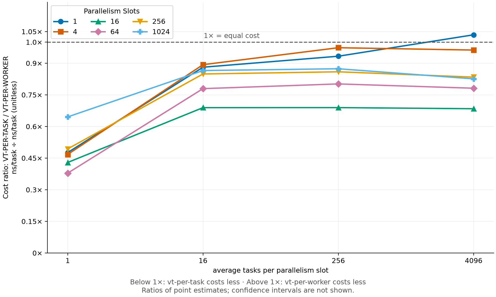
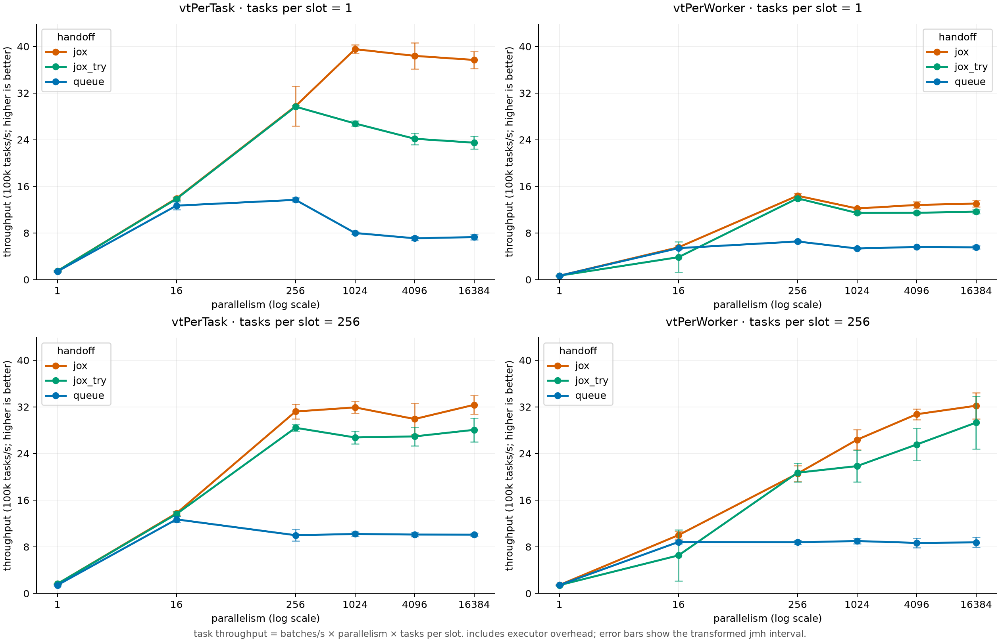
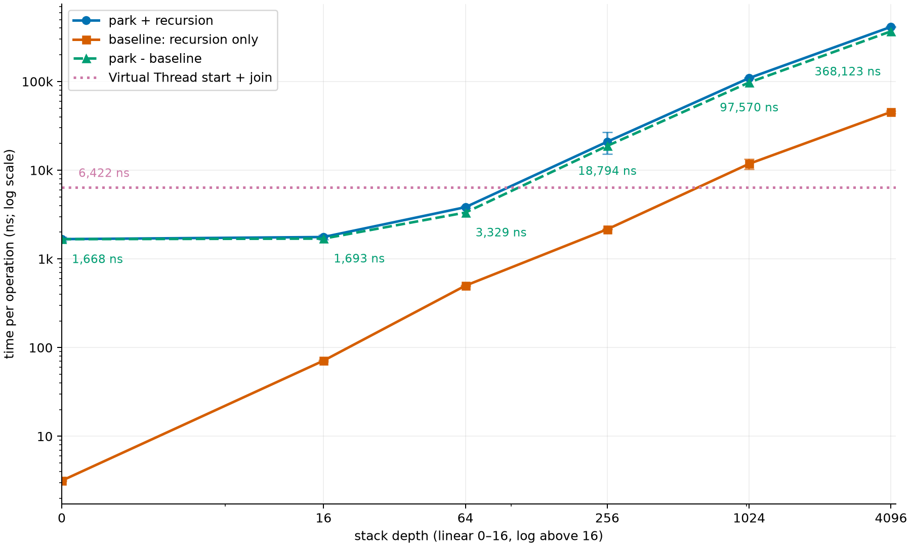
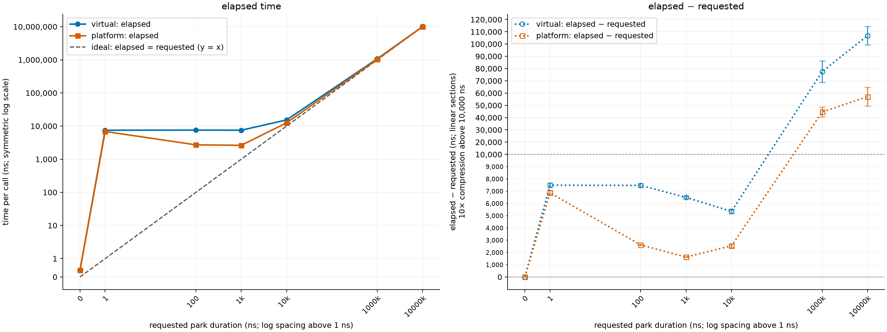

# `kotlinx.coroutines` on top of Project Loom Virtual Threads

This document investigates the viability of integrating Project Loom Virtual Threads
with `kotlinx.coroutines`, primarily from a performance perspective.

## Summary

A short summary of the document for quick reference:

* We investigated the following question:
  What is the performance cost of running Kotlin coroutines on Virtual Threads
  when an application uses suspending APIs without blocking worker threads?

* We compared `Dispatchers.Default` with dispatchers backed by Virtual Threads (VTs) that:

  * create a VT per dispatched task;
  * batch multiple tasks on a VT;
  * reuse a VT per coroutine.

  All approaches retain Kotlin's existing suspension mechanism.

* We measured throughput in rsocket-kotlin's request-response, request-stream, and request-channel benchmarks
  using suspending TCP APIs.

  * All tested VT integration approaches reduced throughput compared with `Dispatchers.Default`
    on the evaluated rsocket-kotlin workloads.
  * Reducing scheduler handoffs and custom batching narrowed the gap.
  * The best custom batching configuration still trailed `Dispatchers.Default` by 12.5% on JVM 21 and 7.9% on JVM 26 on the request-stream workload.

* Isolated JVM benchmarks explored VT creation versus reuse, parking at different stack depths, and timed parking.

  * The results suggest that reusing VTs can incur more coordination overhead than creating new ones.
  * They do not establish the cause of the remaining coroutine throughput gap or whether it can be closed.

* These results do not support out-of-the-box VT integration in `kotlinx.coroutines` at this point.

* VTs may still benefit code that blocks threads, but that potential benefit was not measured here.

# Project Loom

[Project Loom](https://openjdk.org/projects/loom/) introduces to JVM:
* Virtual Threads - lightweight threads supported by JVM and scheduled by the JDK.
* Structured Concurrency - standard library facility for managing related concurrent tasks.
* Scoped Values - a way to implicitly share context values in a scope.

This document explores only Virtual Threads integration, leaving other features out of scope.

## Virtual Threads vs `kotlinx.coroutines`

A short comparison of Virtual Threads and `kotlinx.coroutines` is presented below.

Virtual Threads are designed to be a drop-in replacement for platform threads on JVM, so they expose mostly the same API.
Internally, Virtual Threads use stackful JVM continuations.
When a VT unmounts, its stack frames are saved in heap-allocated stack chunks (**freezing**); 
when it mounts again, frames are restored for execution (**thawing**).
This continuation machinery is not exposed through the public API.

Virtual Threads are executed by a `ForkJoinPool` backed by platform threads.
Platform thread executing a VT at a particular moment is called its **carrier**.
The proposed value of VTs is that supported blocking operations can unmount a virtual thread and free its carrier,
thus allowing applications to scale better by avoiding CPU starvation.
However, this is not always the case and blocking a VT may block its carrier, 
a situation called **carrier pinning**.

On the other hand, `kotlinx.coroutines` are **stackless**, i.e. on coroutine suspension,
the entire stack is unwinded and necessary state is saved on the heap (but not in the form of stack frames).
On continuation resumption, the call stack is restored using the saved state and compiler-generated state machines.
To make this possible, `suspend` functions are compiled in a specific way (with continuation passing style).
This is a practical reason for **code coloring** - the rule that non-`suspend` functions could not call `suspend` ones.
Such limitation is not imposed by thread-based concurrency, and by Virtual Threads in particular.

`kotlinx.coroutines` is also much more flexible than Virtual Threads.
Kotlin exposes public continuation APIs like `Continuation` and `ContinuationInterceptor`.
Execution of coroutines is also configurable through dispatchers, in contrast to 
Virtual Threads, whose carrier scheduler cannot be chosen through the public API.

# Previous Work

Nikita Bobko's [research](https://github.com/Kotlin/KEEP/blob/bobko/loom/notes/0007-project-loom.md) explores
Virtual Threads' integration with `suspend` functions, i.e. on the language level,
or `kotlinx.coroutines`, i.e. on the library level, from design perspective.
A short summary:
* **Language level:** Virtual Threads cannot replace Kotlin's implementation of `suspend` functions: 
  JVM continuations are not public, carrier threads cannot be chosen, 
  while Kotlin coroutines need precise control to support uses such as sequences and UI dispatch.
* **Library level:** Running `kotlinx.coroutines` on Virtual Threads is possible, 
  but Kotlin's continuation transformation would still be performed, so developers pay the price for it. 
  Also, blocking at unmarked points with VTs obscures suspension points and complicates the model.
* **Conclusion:** Use Virtual Threads directly where they fit.

# Research

## Problem

Why could it still be beneficial to run coroutines on top of Virtual Threads?

It can eliminate the need to distinguish `Dispatchers.Default` 
for CPU-bound work and `Dispatchers.IO` for blocking IO work.
If coroutines are backed by VTs, calling a blocking IO operation
can unmount the VT and release its carrier for other work.
This has the following benefits:
* The user does not need to carefully mark IO operations with `withContext(Dispatchers.IO)`.
* Many submitted operations use smaller amount of platform threads.
* Throughput of an application could potentially increase if it does a lot of blocking operations.

Virtual Threads can also help with **thread-pool starvation**.
All workers of `Dispatchers.Default` (or `IO`) can be waiting for some blocking operation, while a task that 
should produce the result for this operation is scheduled on the same dispatcher and thus can not be executed.
This situation causes a deadlock and prompted IJ Platform to implement [external compensation strategy](https://youtrack.jetbrains.com/issue/IJPL-214442).
Using Virtual Threads, this situation can be avoided: the task can execute on a carrier released by a waiting VT.

**Important to note**, that Virtual Threads could not solve the above problems completely,
as they do not release carriers on many file system operations, blocking native calls and spin-waiting.

## Question

The benefits of using Virtual Threads described above are of value for codebases
that do blocking operations, call potentially blocking Java libraries or even unknown third-party code (e.g. plugins).
If an application uses Kotlin-first libraries and APIs that appropriately
use async calls and adapt them for Kotlin coroutines,
then using Virtual Threads might provide no benefits at all.
Moreover, `Dispatchers.Default` and `Dispatchers.IO` use `CoroutineScheduler` which 
implements custom work-stealing algorithm and presumably is more performant for coroutine execution patterns.

In other words, overall performance difference of using Virtual Threads depends on two things:
* Potential throughput increase from reducing OS-thread blocking.
* Performance impact of switching from `kotlinx.coroutines` provided dispatchers to a custom one.

For the first point, the effect depends highly on the usage pattern of blocking operations.
So this research focuses mostly on the second point:
**what is the performance cost of switching to Virtual Threads backed dispatcher,
if the application uses suspending APIs without blocking worker threads?**.

# Integration

Kotlin coroutines may be executed on Virtual Threads in different ways.

## VT-per-task

The most simple approach is to spawn a Virtual Thread for each `dispatch` call,
it can be achieved like this:

```kotlin
val virtualThreadDispatcher = Executors.newVirtualThreadPerTaskExecutor().asCoroutineDispatcher()
// ...
withContext(virtualThreadDispatcher) {
    doStuff()
}
```

Note that people already use such integration, mainly as an alternative to `Dispatchers.IO`:
[termora](https://github.com/TermoraDev/termora/blob/f0acbb40845c4ab2ddeb588951204ee9a9f727a9/plugins/vnc/src/main/kotlin/app/termora/plugins/vnc/VNCViewer.kt#L45),
[ort-server](https://github.com/eclipse-apoapsis/ort-server/blob/ea2335c03d86a8b726a73ee53089b45308606afa/shared/coroutines/src/main/kotlin/Dispatchers.kt#L48).

## Reusing VTs

Even though in the Virtual Threads JEP it is explicitly written that one should not pool Virtual Threads,
creating VT on each `dispatch`, i.e. on each dispatched resumption, might be too expensive,
as there is still some cost of creating a new virtual thread.

### Batching Tasks

One idea is to let already running Virtual Thread workers to execute multiple tasks submitted to the dispatcher.
VT worker exits normally when there are no more tasks to execute at the moment (it **does not park** to wait for more tasks).
Interestingly, this behavior can be easily approximated by available `kotlinx.coroutines` tools:

```kotlin
val batchedVirtualThreadDispatcher = 
    Executors.newVirtualThreadPerTaskExecutor()
        .asCoroutineDispatcher()
        .limitedParallelism(64)
```

The thing is that `LimitedDispatcher` internally submits `Worker` instances to the underlying dispatcher.
Those workers poll tasks from a shared queue, exiting normally if no tasks are available.
Workers also redispatch themselves after 16 tasks if more work remains, causing a new VT to be created.
However, the downsides of this approach are:
* The number of concurrent workers is capped.
* Dispatcher prefers to spawn new workers if parallelism is not fully utilized.

So in our test below we also utilized a custom dispatcher with a similar idea, but:
* With an ability to spawn unlimited number of workers.
* With a heuristic to avoid spawning new workers if existing ones can handle the load 
  (under assumption that workers make progress, i.e. they do not block).
* With a configurable maximum number of tasks executed per VT.

Relevant part of the implementation:

```kotlin
override fun dispatch(context: CoroutineContext, block: Runnable) {
    queuedTasks.incrementAndGet()
    queue.add(block)
    startWorker()
}

private fun needsWorker(): Boolean {
    if (queue.isEmpty()) return false
    val workers = activeWorkers.get()
    return workers == 0L || queuedTasks.get() > workers * expandThreshold
}

private fun startWorker() {
    while (needsWorker()) {
        if (!expandingWorkers.compareAndSet(false, true)) return
        try {
            while (needsWorker()) {
                activeWorkers.incrementAndGet()
                underlying.dispatch(EmptyCoroutineContext) { runBatch() }
            }
        } finally {
            expandingWorkers.set(false)
        }
    }
}

private fun runBatch() {
    try {
        repeat(batchSize) {
            val task = queue.poll() ?: return
            queuedTasks.decrementAndGet()
            try {
                task.run()
            } catch (e: Throwable) {
                val thread = Thread.currentThread()
                thread.uncaughtExceptionHandler.uncaughtException(thread, e)
            }
        }
    } finally {
        activeWorkers.decrementAndGet()
        startWorker()
    }
}
```

Full code is available [here](https://github.com/InversionSpaces/rsocket-kotlin/blob/loom-dispatcher-benchmark/rsocket-transport-benchmarks/rsocket-kotlin/src/jvmMain/kotlin/BatchedVirtualThreadDispatcher.kt).

### VT-per-coroutine

Another idea is to establish a correspondence between a unit of work, `Job` in `kotlinx.coroutines`, and a Virtual Thread.
In other words, a VT is live until a `Job` completes, parking when there is no work to execute at the moment.
The idea is similar to the one proposed in Nikita Bobko's research, see [Previous Work](#previous-work).
Relevant part of the implementation:

```kotlin
override fun dispatch(context: CoroutineContext, block: Runnable) {
    val job = context[Job]
    if (job == null) {
        executorService.execute(block)
        return
    }

    val task = Task(context, block)
    while (true) {
        var created = false
        val worker = workers.computeIfAbsent(job) {
            created = true
            CoroutineWorker(job)
        }
        if (worker.enqueue(task)) {
            if (created) worker.start()
            return
        }
        workers.remove(job, worker)
    }
}

private class CoroutineWorker(private val job: Job) : Runnable {
  private val queue = ConcurrentLinkedQueue<Task>()

  private val pendingTasks = AtomicInteger(0)

  @Volatile
  private var completed = false

  @Volatile
  private var thread: Thread? = null

  fun start() {
    job.invokeOnCompletion {
      completed = true
      signal()
    }
    executorService.execute(this)
  }

  fun enqueue(task: Task): Boolean {
    while (true) {
      val pending = pendingTasks.get()
      if (pending == CLOSED) return false
      if (pendingTasks.compareAndSet(pending, pending + 1)) break
    }
    queue.offer(task)
    signal()
    return true
  }

  override fun run() {
    thread = Thread.currentThread()
    while (true) {
      val task = queue.poll()
      if (task != null) {
        try {
          task.block.run()
        } catch (failure: Throwable) {
          handleCoroutineException(task.context, failure)
        } finally {
          pendingTasks.decrementAndGet()
        }
        continue
      }

      if (completed && pendingTasks.compareAndSet(0, CLOSED)) {
        workers.remove(job, this)
        return
      }

      LockSupport.park(this)
    }
  }

  private fun signal() {
    thread?.let(LockSupport::unpark)
  }

  private companion object {
    const val CLOSED = -1
  }
}
```

The full code is available [here](https://github.com/InversionSpaces/kotlinx.coroutines/blob/mvorobev/virtual-threads/kotlinx-coroutines-core/jvm/src/VirtualThreads.kt).

# Benchmarks

Benchmarks (and profiles, where applicable) were performed on Apple M3 Max;
the macOS profiler used a wall-clock sampling engine.

## rsocket-kotlin

All benchmarks and profiles in this section used JVM 21.0.10 (see JVM 26 update below).

[rsocket-kotlin](https://github.com/rsocket/rsocket-kotlin) is a Kotlin Multiplatform implementation of
the RSocket messaging protocol, using coroutines and `Flow` for asynchronous requests and streams.
We used its client/server transport benchmarks over a Ktor TCP loopback connection, with empty payloads:

| Benchmark        | Concurrent requests | Work per request                          |
|------------------|--------------------:|-------------------------------------------|
| Request-response |               1,000 | One request and one response              |
| Request-stream   |                 100 | One request and 5,000 response elements   |
| Request-channel  |                  10 | Bidirectional streaming of 5,000 elements |

Requests are generated by concurrent coroutines on one JMH thread. 
Connection and RSocket processing use either four Default workers or 
a VT scheduler configured with four carriers; the selector has one dedicated platform thread.
Scores below are **complete benchmark invocations per second**,
`±` denotes the reported 99.9% confidence interval across 15 samples.

This workload uses suspending socket APIs, so it explores the dispatcher cost discussed in [Question](#question),
rather than the potential benefit of handling blocking I/O.
The full experiment log and reproduction commands are available in the
[benchmark report](https://github.com/InversionSpaces/rsocket-kotlin/blob/loom-dispatcher-benchmark/BENCHMARK.md).

### Transport Patches

First, rsocket-kotlin's Ktor TCP transport overwrote the dispatcher supplied in its parent context.
We patched the library to allow the selected dispatcher to reach connection and RSocket processing scopes.
All results below include this change.

Ktor still used `Dispatchers.IO` for its socket reader/writer pumps. 
In the VT variant this introduced handoffs between two schedulers: 
four VT carriers and a separate pool of four coroutine workers.
We [patched Ktor](https://github.com/InversionSpaces/ktor/commit/8c189f0ed) to expose an optional `ioDispatcher` 
in TCP client/server socket options and pass it through to the reader/writer pumps, including accepted sockets. 
In the benchmark, both client and server socket read/write coroutines use the selected connection dispatcher.
With this patch, both benchmark variants have a relevant platform-thread ceiling of six: 
* Four workers/carriers.
* One selector thread.
* One JMH generator thread.
* JVM service threads are excluded.

### VT-per-task

We first compared [VT-per-task](#vt-per-task) with `Dispatchers.Default`, before and after the Ktor I/O patch:

| Benchmark        |   Default, ops/s |        VT, ops/s | VT diff before | Default after, ops/s |  VT after, ops/s | VT diff after | VT gain |
|------------------|-----------------:|-----------------:|---------------:|---------------------:|-----------------:|--------------:|--------:|
| Request-response | 623.470 ± 16.650 | 537.522 ± 23.186 |         -13.8% |     659.821 ± 19.017 | 619.838 ± 15.736 |         -6.1% |  +15.3% |
| Request-stream   |    5.842 ± 0.215 |    2.818 ± 0.116 |         -51.8% |        5.840 ± 0.261 |    3.923 ± 0.058 |        -32.8% |  +39.2% |
| Request-channel  |   35.160 ± 1.244 |   19.568 ± 0.068 |         -44.3% |       34.429 ± 1.195 |   28.222 ± 0.383 |        -18.0% |  +44.2% |

VT diffs are relative to Default in the corresponding before/after run; 
VT deff gain is the throughput increase from before to after the patch.

For the VT-per-task variant, request-stream profiles taken before and after the Ktor patch showed
less scheduler wait/signal activity and lower system CPU load, supporting the hypothesis that
scheduler handoffs contributed to the throughput gap with Default.

However, VT-per-task approach shows significant performance decrease compared to `Dispatchers.Default`.
The hypothesis emerged that the overhead of creating a VT is the cause, so we tried reusing VTs.

### Batching tasks

We compared the [batching approaches](#batching-tasks) on the patched Ktor request-stream workload.

| Dispatcher                                                | Throughput, ops/s | Difference from Default | Avg tasks/batch | Empty workers |
|-----------------------------------------------------------|------------------:|------------------------:|----------------:|--------------:|
| Default                                                   |     6.155 ± 0.164 |                      0% |               — |             — |
| VT-per-task                                               |     3.714 ± 0.350 |                  -39.7% |               — |             — |
| Custom batching dispatcher, <br/>maximum 1 task in batch  |     3.254 ± 0.036 |                  -47.1% |            1.00 |         0.00% |
| Custom batching dispatcher, <br/>maximum 4 task in batch  |     4.295 ± 0.046 |                  -30.2% |            4.00 |         0.00% |
| Custom batching dispatcher, <br/>maximum 16 task in batch |     5.155 ± 0.041 |                  -16.2% |           15.72 |         0.58% |
| Custom batching dispatcher, <br/>maximum 64 task in batch |     5.384 ± 0.130 |                  -12.5% |           46.69 |         9.05% |
| VT-per-task + `limitedParallelism(1)`                     |     4.089 ± 0.009 |                  -33.6% |               — |             — |
| VT-per-task + `limitedParallelism(4)`                     |     4.007 ± 0.072 |                  -34.9% |               — |             — |
| VT-per-task + `limitedParallelism(16)`                    |     4.065 ± 0.149 |                  -34.0% |               — |             — |
| VT-per-task + `limitedParallelism(64)`                    |     3.961 ± 0.068 |                  -35.6% |               — |             — |

Worker statistics were recorded only for custom batching dispatcher. 
Empty workers are those that encountered an empty task queue and thus executed no tasks.

The custom batching dispatcher showed a significant performance gain over plain VT-per-task with right configuration,
but still remained behind the `Dispatchers.Default` by 12.5%.
On the other hand, `limitedParallelism` showed no clear improvement over plain VT-per-task 
within the reported uncertainty, for the tested parallelism limits, which is puzzling.

Custom batching dispatcher results are consistent with the hypothesis 
that amortizing VT creation overhead across tasks is beneficial.
However, they do not isolate VT creation cost from scheduling, queue contention, or locality effects.

### VT-per-coroutine and the coroutines patch

To test [VT-per-coroutine](#vt-per-coroutine), we built an [experimental `kotlinx.coroutines`](https://github.com/InversionSpaces/kotlinx.coroutines/compare/ee92d16c4b48345648dcd8bb15f11ab9c3747f67...0ad34502bcdb972490c2a692d7921e449cab96ee#files_bucket)
version, replacing `Dispatchers.Default` with the Job-associated VT dispatcher shown above. 
Kotlin suspension still uses the regular continuation protocol.
The Virtual Thread worker parks between dispatched segments and retires after `Job` completion.

The benchmark's coroutines version override also covers transitive dependencies, 
ensuring Ktor uses the experimental build. 
The comparison uses the same patched Ktor request-stream workload:

| Default implementation        | Throughput, ops/s | Difference from standard |
|-------------------------------|------------------:|-------------------------:|
| Standard `kotlinx.coroutines` |     6.155 ± 0.181 |                        — |
| Experimental VT-per-coroutine |     3.874 ± 0.605 |                   -37.1% |

This approach shows performance decrease compared to `Dispatchers.Default`, similarly to VT-per-task.
Profiles still showed VT unpark/ForkJoinPool signalling activity.

Our hypothesis was that the cause is that parking/unparking a Virtual Thread is expensive.
The need to freeze and then thaw the thread's stack on unmount and remount might be the cause.
However, in the current setup the worker thread does not have a deep stack on the moment of parking,
as it is unwinded when a coroutine suspends.

### Update: JVM 26

We reran the patched Ktor request-stream benchmarks on JVM 26.
We also had to update Kotlin from `2.1.10` to `2.4.10` and AtomicFU from `0.27.0` to `0.33.0`;
the Ktor and `kotlinx.coroutines` versions remained unchanged.
Code is available [here](https://github.com/InversionSpaces/rsocket-kotlin/tree/loom-dispatcher-benchmark-jvm26).

Results for VT-per-task and batching approaches:

| Dispatcher                                                 | Throughput, ops/s | Difference from Default |
|------------------------------------------------------------|------------------:|------------------------:|
| Default                                                    |     5.438 ± 0.081 |                      0% |
| VT-per-task                                                |     3.611 ± 0.106 |                  -33.6% |
| Custom batching dispatcher, <br/>maximum 1 task in batch   |     3.135 ± 0.054 |                  -42.4% |
| Custom batching dispatcher, <br/>maximum 4 tasks in batch  |     4.025 ± 0.079 |                  -26.0% |
| Custom batching dispatcher, <br/>maximum 16 tasks in batch |     4.810 ± 0.080 |                  -11.5% |
| Custom batching dispatcher, <br/>maximum 64 tasks in batch |     5.009 ± 0.130 |                   -7.9% |
| VT-per-task + `limitedParallelism(1)`                      |     3.689 ± 0.073 |                  -32.2% |
| VT-per-task + `limitedParallelism(4)`                      |     3.775 ± 0.049 |                  -30.6% |
| VT-per-task + `limitedParallelism(16)`                     |     3.656 ± 0.110 |                  -32.8% |
| VT-per-task + `limitedParallelism(64)`                     |     3.603 ± 0.131 |                  -33.7% |

And for VT-per-coroutine:

| Default implementation        | Throughput, ops/s | Difference from standard |
|-------------------------------|------------------:|-------------------------:|
| Standard `kotlinx.coroutines` |     5.438 ± 0.081 |                        — |
| Experimental VT-per-coroutine |     3.422 ± 0.275 |                   -37.1% |

The lower throughput across all entries compared with the JVM 21 runs could be due to the Kotlin version change or machine conditions.
The overall picture remains similar: all tested Virtual Thread approaches still have lower throughput than `Dispatchers.Default`.

## Isolated Benchmarks

To investigate the overheads suggested by the rsocket-kotlin results, 
we proceeded to write isolated benchmarks for Virtual Threads, without Kotlin coroutines.
Benchmarks code is available [here](https://github.com/InversionSpaces/loom-playground/tree/main/src/jmh/kotlin/org/example).

JVM version: 26.

### VT-per-task vs VT-per-worker

This benchmark compares VT-per-task and VT-per-worker strategies for tasks execution.
Both benchmark variants have same structure with fixed number of parallelism slots
and a coordinator thread submitting new task for the slot once the previous one completes.

<details>
<summary>Benchmark Code</summary>

```kotlin
@Benchmark
fun vtPerTask(): Int = Executors.newVirtualThreadPerTaskExecutor().use { threads ->
    runTasks(List(parallelism) { threads })
}

@Benchmark
fun vtPerWorker(): Int {
    // One pending task at most; the second cell is reserved for the stop marker.
    val queues = List(parallelism) { ArrayBlockingQueue<Runnable>(2) }
    val stop = Runnable {}
    return Executors.newVirtualThreadPerTaskExecutor().use { threads ->
        try {
            val workers = queues.map { queue ->
                threads.submit {
                    while (true) {
                        val task = queue.take()
                        if (task === stop) break
                        task.run()
                    }
                }
                Executor { task -> queue.add(task) }
            }
            runTasks(workers)
        } finally {
            queues.forEach { it.add(stop) }
        }
    }
}

private fun runTasks(executors: List<Executor>): Int {
    require(parallelism > 0 && tasksPerSlot > 0)
    val total = Math.multiplyExact(parallelism, tasksPerSlot)
    val completed = LinkedBlockingQueue<Future<Pair<Int, Int>>>()
    val slots = executors.map { ExecutorCompletionService(it, completed) }

    fun submit(slot: Int) {
        slots[slot].submit { slot to unitOfWork() }
    }

    repeat(parallelism) { submit(it) }
    var remaining = total - parallelism
    var res = 0
    repeat(total) {
        val (slot, value) = completed.take().get()
        res += value
        if (remaining > 0) {
            submit(slot)
            remaining--
        }
    }
    return res
}
```

</details>

The benchmark aims to trade Virtual Thread creation/destruction for parking/unparking.
Results are:



Cost is elapsed batch time divided by the number of tasks, so it reflects throughput rather than task latency.

Results are consistent with the hypothesis that coordination of Virtual Threads involving parking/unparking
is more expensive than on demand creation/destruction.

We've also run the benchmark with Java concurrent queues replaced by channels from [jox](https://github.com/softwaremill/jox),
which advertises itself as a library of Virtual Thread friendly concurrency primitives.
The code is available [here](https://github.com/InversionSpaces/loom-playground/tree/jox).
Results are (`jox_try` uses `trySend` and `tryReceive` before falling back to `send` and `receive` on a channel):



This allowed both vt-per-task and vt-per-worker approaches to scale better with parallelism,
probably due to reduced contention on the shared completion queue
(Jox avoids serializing producers behind a shared lock, whereas Java `LinkedBlockingQueue` uses one).
However, the overall tendency is similar: vt-per-task outperforms or is on par with vt-per-worker.
Jox’s rendezvous channels spin before parking (see [Softwaremill articles](#softwaremill) for more details on that),
but this optimization is disabled for the buffered channels used here.
Avoiding parking would work against this benchmark’s aim of exercising worker parking/unparking between tasks.

### Parking at Different Stack Depths

This benchmark aims at determining cost of parking/unparking a Virtual Thread 
depending on its stack depth.

<details>

<summary>Benchmark Code</summary>

```kotlin
@Setup(Level.Trial)
fun setup() {
    check(Thread.currentThread().isVirtual) { "Requires a virtual JMH worker; check fork settings" }
    val worker = Thread.currentThread()
    parkRequested = false
    running = true
    unparker = Thread.ofPlatform().daemon(true).name("stack-depth-unparker").start {
        while (running) {
            if (parkRequested && LockSupport.getBlocker(worker) === this &&
                worker.state == Thread.State.WAITING
            ) {
                parkRequested = false
                LockSupport.unpark(worker)
            } else {
                Thread.onSpinWait()
            }
        }
    }
}

@TearDown(Level.Trial)
fun teardown() {
    running = false
    unparker?.join()
    unparker = null
}

@Benchmark
fun park(): Long = parkAtDepth(stackDepth, true)

@Benchmark
fun baseline(): Long = parkAtDepth(stackDepth, false)

@CompilerControl(CompilerControl.Mode.DONT_INLINE)
fun parkAtDepth(remaining: Int, shouldPark: Boolean): Long {
    val a = payload
    val b = payload
    val c = payload
    val d = payload
    val e = payload
    val f = payload
    val g = payload
    val h = payload
    val result = if (remaining == 0) {
        if (shouldPark) {
            parkRequested = true
            do {
                LockSupport.park(this)
            } while (parkRequested)
        }
        1L
    } else {
        parkAtDepth(remaining - 1, shouldPark) + remaining
    }
    return consumeLocals(result, a, b, c, d, e, f, g, h)
}
```

</details>

Results also include the cost of starting and joining a Virtual Thread, 
i.e. time of `Thread.ofVirtual().start {}.join()`.
The chart is below:



Results are consistent with the hypothesis that the cost of parking/unparking 
a Virtual Thread depends linearly on the stack size at the moment of parking.
However, results also suggest that at small stack depths parking/unparking
is cheaper than spawning and waiting for a VT.

### Timed Parking

We also tried to isolate the cost of parking/unparking a Virtual Thread
by measuring the time of `LockSupport.parkNanos(parkingTime)`.
MacOS timer coalescing was disabled during this benchmark (`kern.timer.coalescing_enabled=0`) 
to reduce delays from grouping timer wakeups.
Results include the same benchmark for platform threads:



Results show `elapsed - requested` time several times larger than
that measured in [Parking at Shallow Stack](#parking-at-different-stack-depths).
The excess includes timer handling, wakeup delays, and scheduling overhead.

# External Research

## Softwaremill

Softwaremill article [Limits of Loom Performance](https://softwaremill.com/limits-of-looms-performance/)
compares the performance of a custom implementation using Kotlin coroutine continuations
and Virtual Threads on 10 million rendez-vous operations.
As a short summary, authors also had to apply different optimizations for VTs 
to approach or outperform the Kotlin implementation on `Dispatchers.Default`, including: 
doing `Thread.yield()` or `Thread.onSpinWait()` a number of times before parking, using Java's `Exchanger`.

They apply those findings to their channel library jox, see [Announcing jox](https://softwaremill.com/announcing-jox-fast-and-scalable-channels-in-java/) article.

## Quarkus

Quarkus article [To Cache or Not to Cache Virtual Threads](https://quarkus.io/blog/to-cache-or-not-to-cache-virtual-threads/)
explores performance gain of pooling Virtual Threads in a typical web-app workload.
In short, authors find small throughput increase when pooling VTs.
However, they note that it has a significant memory footprint downside:
on warm-up, JVM allocates a big `StackChunk` for freezing a Virtual Thread,
As code gets optimized, subsequent freezes need less space, 
but pooled workers retain older, oversized chunks containing entry frames until their worker loops exit.

# Conclusion

Benchmarks for [rsocket-kotlin](#rsocket-kotlin) show that all considered approaches for running Kotlin coroutines
on top of Virtual Threads introduce significant performance downgrade, at least for some patterns of coroutines usage.
At this point, we are unsure what are the causes and whether further changes could close the remaining performance gap.
This makes it unappealing to provide any out-of-the box support for Virtual Threads in Kotlin coroutines.

Virtual Threads still can provide overall benefit depending on the codebase,
but it should remain a mindful developer's choice.
Thanks to Kotlin coroutines flexibility, it is not hard to run coroutines on top of Virtual Threads implementation-wise.
